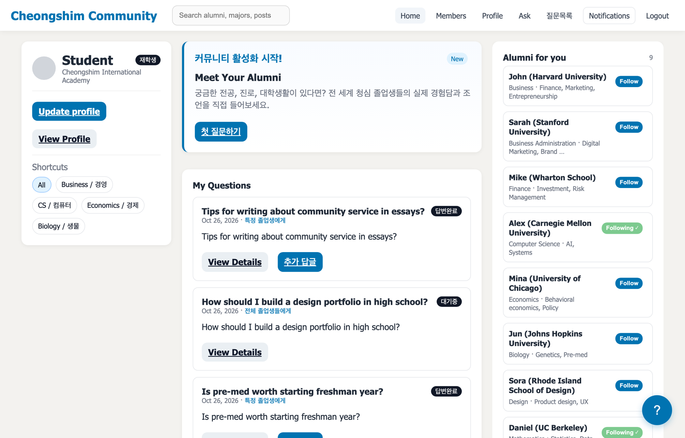
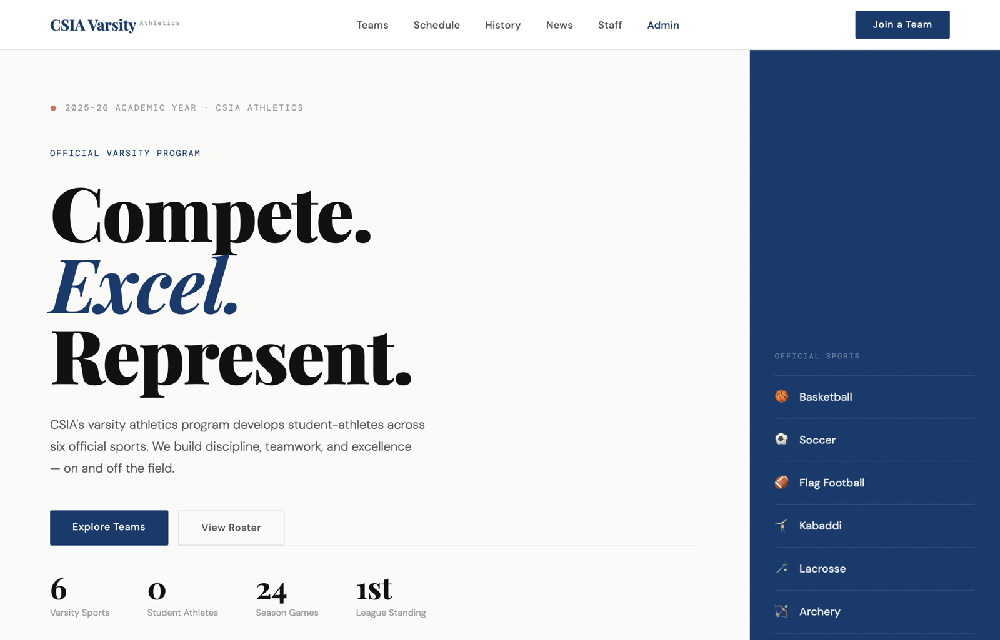
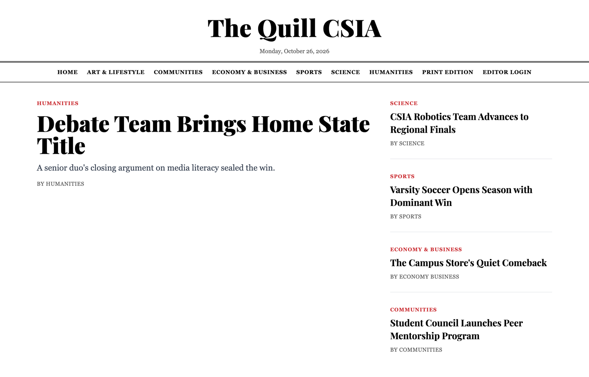
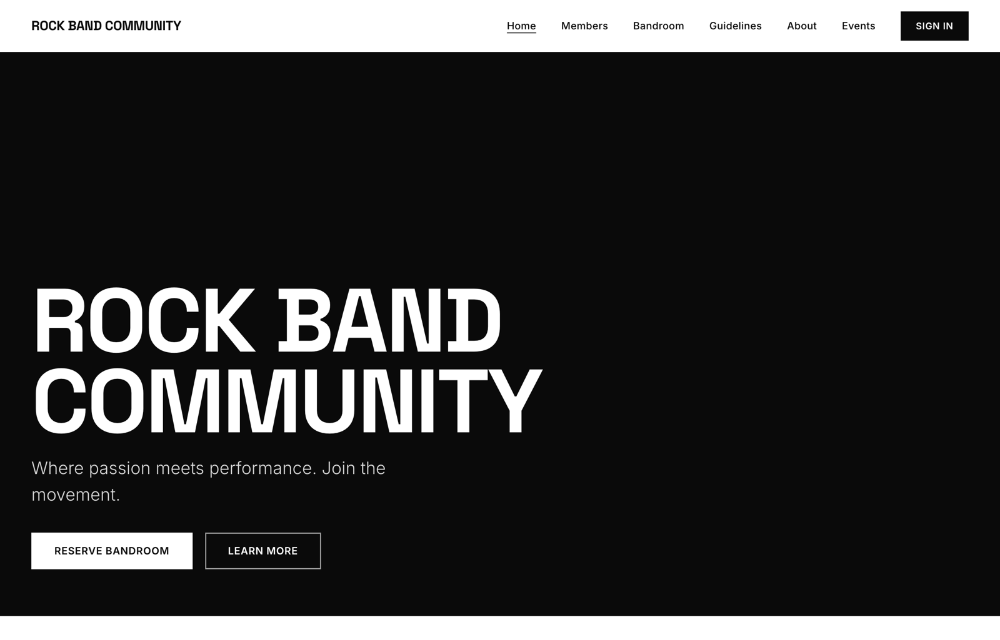
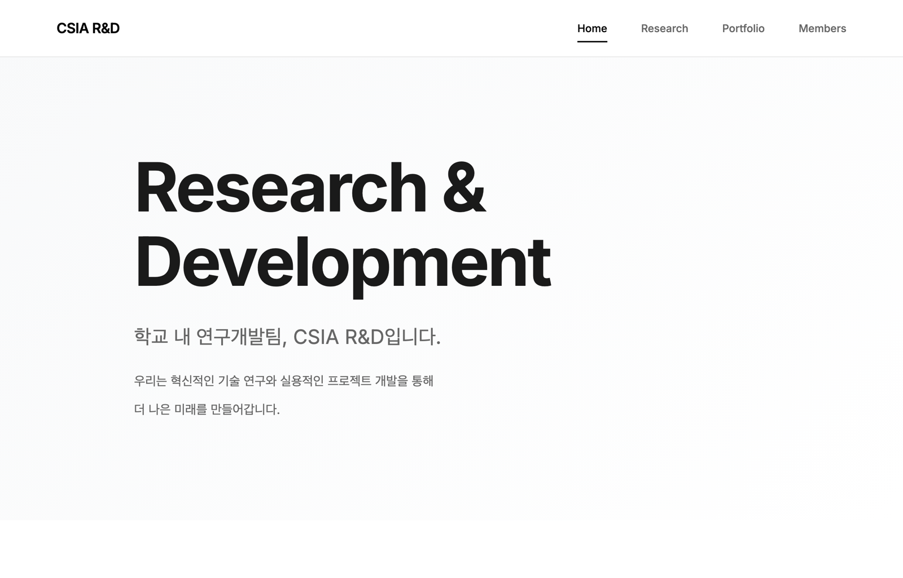

# CSIA School Sites

**Five Django sites I built for student organizations at CheongShim International Academy.**

> Source code stays private because the production databases hold student accounts. Screenshots use fictional demo data.

| Site | For | What it does | Built |
|:--|:--|:--|:--|
| [CSIA Community](#csia-community) | Students and alumni | Anonymous Q&A that connects current students with alumni | 2025 |
| [CSIA Varsity](#csia-varsity) | Athletics program | Teams, rosters, schedules, news, and staff for six varsity sports | 2026 |
| [The Quill](#the-quill) | Student newspaper | News site with a department-scoped editor dashboard | 2026 |
| [Rock Band Community](#rock-band-community) | Rock band | Band pages, events, and band room reservations | 2024 – 2026 |
| [CSIA R&D](#csia-rd) | Research club | Research, portfolio, and member pages | 2025 – 2026 |

---

### CSIA Community

Students ask questions anonymously and choose who receives them: all alumni, alumni they follow, or one specific alumnus. Alumni profiles can be searched by major, university, and interests, and notifications keep both sides updated on answers and follow-ups.

### CSIA Varsity

The official site for the varsity athletics program. Each of the six sports has its own roster, schedule, and news, and an admin area lets staff update them without touching code.

### The Quill

The student newspaper's site, organized into six department sections. Editors manage only their own department's articles and move them from draft to published to archived; admins see everything.

### Rock Band Community

The home of the CSIA Rock Band Community: band pages, events, guidelines, and a band room reservation system with admin-set time blocks.

### CSIA R&D

The research club's site, with pages for ongoing research, finished portfolio projects, and members.

---

**Stack:** Django · Python · JavaScript · HTML/CSS · SQLite (development)

All names, questions, and articles in the screenshots are fictional.
